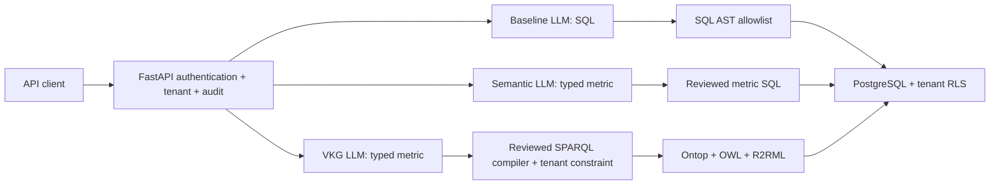

# Architecture and trust boundaries

Models are untrusted. Baseline output is restricted to a scalar COUNT/SUM/AVG
on the non-PII campaign_facts relation. Every request uses a server-configured
identity; request bodies cannot choose a role or tenant. SQL transactions set
app.tenant locally, are read-only, and have a five-second statement timeout.
PostgreSQL security-invoker views preserve caller RLS and column privileges.
A baseline may be semantically incorrect while remaining policy compliant.

Semantic mode selects an enum metric and compiles reviewed SQL. VKG mode selects
the same enum, compiles SPARQL and sends it to the actual Ontop endpoint. Ontop
performs ontology rewriting and SQL unfolding; the application does not emulate
this step. EligibleCustomer is a subclass of MarketableCustomer. Mappings assert
only EligibleCustomer; queries request MarketableCustomer, exercising subclass
inference. Age, active status and consent are grounded in the SQL-backed mapping,
not inferred from absent RDF facts. OWL open-world reasoning is not consent policy.

The Ontop service account can read all tenants' non-PII facts. Tenant isolation on
this path relies on the server's closed SPARQL compiler. Ontop and PostgreSQL are
private Compose services and must not be exposed outside the trusted network.
Never add an arbitrary SPARQL endpoint or forward model-produced SPARQL without
additional authorization. For stronger isolation deploy separate Ontop instances
and database roles per tenant. Ontology reasoning itself does not enforce access.

## Semantics

Eligible customers: distinct adult (age >= 18), active, consented customers.
Conversions: distinct eligible customers with at least one subscribed contact.
Conversion rate: conversions / eligible customers; empty populations return zero.
The fixture spans two tenants, 200 customers, 600 contacts, multiple campaigns,
channels, dates and segments, including minors, opt-outs, inactive customers and
repeated contact. Current supported metrics span all dates and campaigns; campaign
or date filtering is not yet supported and should not be inferred from questions.

## Operations

JSONL audit records contain subject, tenant, mode, request ID, question hash,
outcome and successful execution latency. Questions, tokens and query results are
not stored. An audit write failure prevents successful responses. Local append
logs are not tamper-proof; production requires an external durable audit sink,
retention controls, rotation and restricted access. Failed authentication and
policy failures are logged. FastAPI schema validation failures use its default
422 handler and are not part of the query audit stream.

Health reports process liveness; dependency failures return 503. Requests have
bounded input, model/HTTP/database timeouts and scalar output. Add TLS, a secret
manager, gateway rate limiting, centralized observability, model evaluation,
image digest pinning and organization-specific authorization before production.
Local database passwords are intentionally public demo credentials on synthetic
data. Never reuse them with real banking records.
